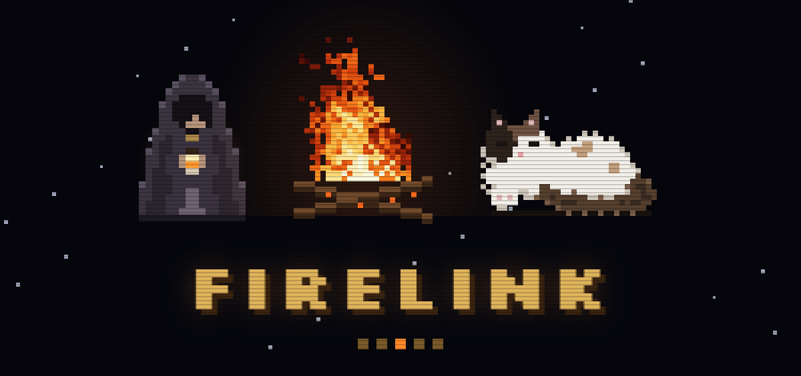

<h1 align="center"></h1>

A home server built on an old laptop: shared folders for the family, movies and
classes on the TV and phones, comics and books in the browser, and a pixel-art home
page with a bonfire, a hooded keeper and Akali, the house cat.

Everything runs on the local network only. Nothing is exposed to the internet.

The home page interface is in Brazilian Portuguese, the language of the household.

## Hardware

| Item | Value |
|---|---|
| Laptop | ASUS X550C (2013) |
| CPU | Intel Core i5-3317U (Ivy Bridge, 4 threads), Intel HD 4000 graphics |
| Memory | 6 GB |
| Disk | 2.5" 500 GB HDD (451 GiB usable) |
| Network | Gigabit Ethernet (RTL8111), wired to the router |
| Power draw | ~7–12 W idle, lid closed |

## Services

| Service | Purpose | Where |
|---|---|---|
| Debian 13 (no desktop) | operating system | — |
| Samba + wsdd2 + Avahi | a shared `bau` folder plus one personal folder per person; shows up under *Network* on Windows and as `firelink.local` | `\\firelink`, `smb://firelink.local` |
| Jellyfin | movies, animations, series and recorded classes, with VA-API (i965) hardware acceleration for H.264, MPEG-2 and VC-1 | `:8096` |
| Kavita | comics (CBZ/CBR/PDF) and books (EPUB/PDF) with per-person reading progress, in the Firelink theme | `:5000` |
| Caddy | home page and `/api/` proxy | `:80` |
| firelink-api | service status, Akali's scoreboard and the household chat (Python, standard library only) | `127.0.0.1:8091` |
| AdGuard Home | DNS for the whole house: blocks trackers, malware and phishing domains and ads, with no query log and no statistics | `:53`, panel `:3000` |
| nftables | accepts new connections from the home network only | — |
| smartd + firelink-smart | disk self-tests (short daily, long weekly) and a summary for the home page | — |
| unattended-upgrades | automatic security updates | — |

## Repository layout

```
page/         home page (a single HTML file) and the household config example
api/          firelink-api, its systemd unit (template) and the install script
scripts/      firelink-smart (disk health)
config/       samba, caddy, nftables, ssh, systemd, cron, apt, disks, adguard and the kavita theme
assets/       README banner (rendered from the home page itself)
```

## The home page

A single HTML file with no dependencies besides two Google Fonts.

- **Pixel-art scene:** a procedurally generated bonfire, rising embers, a hooded keeper
  holding a candle, and Akali sleeping in a loaf pose.
- **The Keeper of the Flame:** on each device's first visit she asks who is there
  ("Quem se aproxima da fogueira?"), remembers the answer (`localStorage`) and greets
  that person by name, with lines that change with the time of day and on special dates.
- **Akali:** her eyes follow the cursor, her tail wags, she purrs (synthesized with the
  Web Audio API) when petted, swats when the cursor gets too close to her face or when
  someone touches her tail, accepts at most three pets in a row, and calls for attention
  ("Rrrrruuuuuuu!!!") when the page sits idle.
- **Server panel:** status lights for Jellyfin and Kavita, uptime, disk health (SMART,
  temperature, last self-test) and Akali's scoreboard of pets and swats per person, shared
  across devices.
- **Menu icons:** each menu button has a pixel icon in the page's style: a magic lantern
  casting a beam for the video library, a red tome with a gold clasp for the e-library, a
  letter sealed with wax for the chat (the seal glows like an ember while there are unread
  messages) and a wooden shield bearing Akali's face. Hovering plays a small animation: the
  lantern's beam flickers, the clasp comes undone, the seal lights up, Akali blinks and
  flicks an ear.
- **The shield:** the shield button and its status light show whether AdGuard Home is
  blocking (raised), paused (lowered, with the minutes left) or not answering (the shield
  cracks and Akali's face turns grey). Anyone
  at home can lower it for 10 minutes, after the keeper asks to confirm, to open a link that a
  blocked tracker broke; it rises again by itself.
- **System monitor:** a one-line summary (CPU, RAM, CPU temperature, disk) that opens, in
  place, into a live monitor in the spirit of the Linux system monitor: a rolling pixel graph
  of CPU use over the last minute with a bar per core, memory in use (without the cache) and
  swap when it is used, network speed with its own graph, CPU temperature and disk space.
  `/api/monitor` reads `/proc` and `/sys` on each request and stores nothing; the page asks
  every second only while the monitor is open and on screen, and every 10 s otherwise.
- **Household chat:** a side panel (full screen on phones) for messages between the
  household's computers, kept on the server (`/api/chat`, a JSON Lines file written only
  when someone sends or reads). Clickable links, a copy button on every message (works over
  plain HTTP), "seen by", and new-message alerts in the tab title, the favicon and the
  keeper's dialogue box, while Akali turns her eyes to the button. Everyone can delete their
  own messages (the content is removed from the server's file too). Messages can be pinned
  (up to 12, shown in a bar at the top of the panel), and there are pixel stickers of Akali:
  poses drawn from photos of her (peeking out of a hood, lying on her side, belly up) and the
  page sprite's poses (asleep, purring, swatting, spooked), always in her everyday look,
  without the season's accessories.
- **Day and night:** a starry sky at night, warm light in the morning.
- **Special dates:** on birthdays, pixel balloons drifting up the page, confetti and a cake whose
  candle can be blown out (tap it to make a wish); a pet's "home birthday" also puts a party
  hat on Akali; New Year gets confetti too.
- **Easter** (Good Friday to Sunday, date computed every year): a basket of eggs by the
  keeper, a pixel bunny that hops across the scene now and then (Akali follows it with her
  eyes), bunny ears on Akali and seasonal lines, plus a relaxed egg hunt over the three
  days: four eggs hidden around the page and a sparkling golden one the bunny drops in
  front of the keeper, with a counter and a celebration when all five are found
  (progress kept per device and per year). Once all five are found, the keeper offers to
  play again, and the counter becomes a restart button (in preview mode it always is).
- **Halloween** (all of October): a green-and-purple ghostly flame, a flickering jack-o'-lantern,
  bats crossing the sky, purple fog over the ground, a ghost peeking from behind the fire
  (Akali hisses and swats at it), a witch hat on Akali, and the Saci (Brazilian folklore)
  hopping by on one leg, puffing his pipe, before vanishing in a whirlwind. On Oct 31, also
  Saci Day, he shows up more often and tapping the pumpkin starts trick-or-treat (a candy
  rain, or one of three pranks).
- **Mother's Day** has its own, gentler look: falling petals, flowers sprouting along the
  ground of the scene, a rose-tinted flame, a bouquet in the keeper's hands, a flower by
  Akali's ear, and an optional letter (from `config.js`) that the keeper hands over and
  that opens as a pixel card, typed letter by letter.
- **Preview mode:** `/?data=MM-DD&hora=H` simulates a date and/or hour, with a visible
  banner and a link to exit (e.g. `/?data=12-25&hora=21`).
- **Christmas season** (Nov 15 to Jan 6): a pixel replica of the household tree (silver
  8-point star, gold straw wreath, bead garlands, red and cream-gold baubles, the teddy
  bear in a red sweater) whose lights alternate between warm and cool modes, a Santa hat
  on Akali and seasonal lines from the keeper. The scene scales down to fit small screens.

All artwork is original. The mood is inspired by Dark Souls; this project is not
affiliated with the game or its creators.

## Rebuilding the server

1. Install Debian 13 *netinst* without a desktop environment, selecting "SSH server" and
   "standard system utilities".
2. Packages: `samba wsdd2 avahi-daemon smartmontools acl hdparm nftables caddy
   unattended-upgrades i965-va-driver`, plus Jellyfin from its official repository
   (`config/apt/jellyfin.sources`).
3. Copy the files under `config/` to the matching paths in `/etc`. First adjust the
   home network range (`192.168.15.0/24`), the network interface name in `smb.conf`
   and the disk path in `config/disks/`.
4. Create the folders under `/srv/firelink` (`bau` plus one per person), a `bau` group
   with a default `rwx` ACL on `bau`, and read access for the `jellyfin` and `kavita`
   system users where needed; set Samba passwords with `smbpasswd -a`.
5. Kavita: extract the latest release `.tar.gz` into `/opt/Kavita` and use
   `config/systemd/kavita.service`. For the theme, run `config/kavita/build.sh` and upload
   `firelink.css` under Settings → Themes; each person then picks it in their own settings.
   It was written for Kavita 0.9.1.4: Dracula colours on a crypt-black base with the ember
   as accent, Cinzel headings, the home page's bonfire beside a FIRELINK wordmark, and Akali
   asleep at the foot of the side menu.
6. Home page: copy `page/index.html` to `/srv/www/firelink/` and create `config.js` next
   to it from `config.example.js`, listing the household members, their birthdays and who
   gets Mother's Day greetings. The API reads the names from the same file.
7. Scripts and API: put the `api/` files and `scripts/firelink-smart` in `~/firelink-api`,
   then run `sudo sh ~/firelink-api/install.sh`.
8. AdGuard Home: download the release `.tar.gz` and `checksums.txt` into the folder with
   `config/adguard/`, run `sudo sh install.sh`, then `python3 configurar.py` (sets the panel
   password and encrypted upstreams), and `sudo sh privacidade.sh` to turn off the query log
   and statistics. For the shield button, run `python3 ~/firelink-api/guardar-senha-adguard.py`.
   Finally, point the router's DHCP DNS at the server, with the router itself as secondary.

## Configuration decisions

- **Firewall on the server itself.** The laptop gets a public IPv6 address; with no NAT
  on IPv6, protection would otherwise depend on the router. `nftables` accepts new
  connections only from `192.168.15.0/24` and `fe80::/10` and rejects everything else.
- **SSH accepts keys only** (`config/ssh/10-key-only.conf`): password login is disabled;
  a local console login still works if the key is lost.
- **Caddy's network filter lives inside a `route` block.** In Caddy's default directive
  order `handle` runs before `respond`, so a `reverse_proxy` inside `handle` would bypass
  the filter for `/api/`. Inside `route`, the written order applies. The filter accepts
  the same sources as the firewall (home IPv4 range, loopback and IPv6 link-local).
- **DNS filtering without a record of who visited what.** AdGuard Home keeps no query log
  and no statistics, so nothing on the server lists the sites anyone opened. It asks
  Quad9 and Cloudflare over DNS-over-HTTPS. The router hands out the server as primary DNS
  and itself as secondary, so the house keeps working, unfiltered, if the server goes down.
  The page checks the shield with a DNS question for a blocked domain, which needs no
  password; only pausing uses the panel login, kept in a mode-600 file outside the repository.
- **Disk with `apm = 254`.** The drive was parking its heads very often (325 thousand load
  cycles recorded); on an always-on server that accelerates wear.
- **Closing the lid does not suspend** (`logind`), and the sleep targets are masked.
- **Kavita needs one subfolder per series or book**, and the volume number must sit
  outside brackets (`Series Vol. 1`), otherwise the file is treated as a one-off special.
- **Household data stays out of Git:** names, birthdays and Mother's Day live in
  `config.js` on the server only. The repository ships a fictional example.

## AI assistance

Developed with [Claude Code](https://claude.com/claude-code) (Anthropic) as an AI coding assistant. Commits it contributed to carry a `Co-Authored-By: Claude` trailer.

## Copyright

© 2026 Gustavo Brandão Amaral. All rights reserved.

No license is granted for this repository, including the code and the pixel art
(Akali and the Keeper of the Flame). You are welcome to read it; reuse or
redistribution requires permission.

Exception: the fonts embedded in the Kavita theme, Cinzel and Silkscreen, belong to their
authors and are distributed under the SIL Open Font License 1.1
(`config/kavita/fonts-licenses/`).
